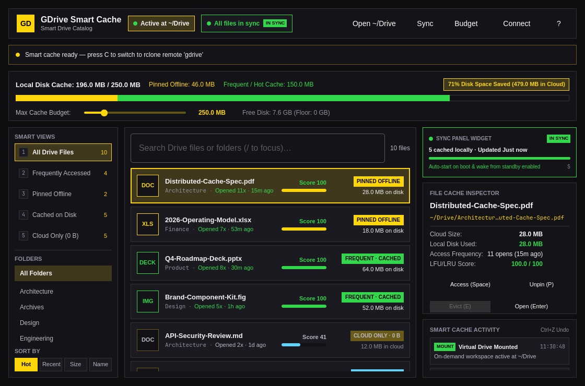

# GDrive

Smart on-demand Google Drive virtual filesystem (`~/Drive`) and LFU/LRU disk cache manager for Omarchy.



## How It Works

`gdrive` replicates Google Drive's on-demand streaming and smart local caching on Linux:

1. **Virtual Filesystem at `~/Drive` (`libfuse3`)**: Cloud files appear in `~/Drive` with their full logical file size while occupying **0 bytes** on local disk until opened.
2. **On-Demand Hydration & Frequency Tracking**: Opening any file in `~/Drive` (or pressing `Space` / `Enter` in the app) downloads it on demand into the local cache (`~/.local/share/gdrive/blobs/`) and records its access count and timestamp.
3. **LFU + LRU Retention Scoring**: Every file has a live **Hot Score (`0–100`)** combining access frequency and exponential recency decay:
   $$\text{Score}(f) = (\text{accessCount} \times 18 + 16) \times 2^{-\Delta t / \tau}$$
   Files that reach the frequent-access threshold are automatically kept warm on disk.
4. **Automatic Disk Space Budget & Free-Space Floor**: Whenever cached files exceed your **Max Cache Budget** or available disk space drops toward your **Minimum Free Disk Floor**, `gdrive` automatically evicts the coldest non-pinned files back to `Cloud Only (0 B)` stubs.
5. **Pinned Offline Files**: Pinning any file (`P`) locks it on local disk so it is never evicted.
6. **Sync Status Panel Widget (In-App + Omarchy Top Bar `ben.gdrive`)**:
   - **Omarchy Top-Bar Plugin (`ben.gdrive`)**: Lives in `~/.config/omarchy/plugins/ben.gdrive/` and displays a live capsule in the Omarchy shell bar indicating when files are **Syncing…** (with file name & transfer percentage) vs **In Sync** (with cached byte count). Clicking the top-bar widget opens a `KeyboardPanel` popup with per-file synchronization status, cache budget bar, and quick actions (`Sync Now`, `Open ~/Drive`, `Launch GDrive`).
   - **In-App Sync Status Panel (`S`)**: Interactive header widget and detailed popup showing real-time transfer progress, file-by-file sync states (`HYDRATING`, `PINNED`, `FREQUENT`, `CACHED`, `CLOUD SYNCED`), and a `Simulate Sync` preview toggle.

## Keyboard Shortcuts

| Shortcut | Action |
| :--- | :--- |
| `Space` | Hydrate on-demand and record access for the selected file |
| `Enter` | Open the selected file from `~/Drive` in its default desktop app |
| `P` | Toggle **Keep Offline** (Pin / Unpin selected file) |
| `E` / `Shift+E` | Evict selected file to Cloud Only / Evict all cold cached files |
| `M` | Mount or unmount the `~/Drive` FUSE3 virtual filesystem |
| `S` | Open the **Sync Status Panel Widget** (syncing vs in-sync monitor) |
| `R` / `F5` | Sync catalog with Google Drive (`rclone`) and enforce disk budget |
| `B` | Open Disk Space Budget & LFU/LRU Eviction Policy settings |
| `C` | Connect Google Drive (`rclone` OAuth remote or local mirror folder) |
| `O` | Open `~/Drive` in the system file manager |
| `1` – `5` | Switch view: All, Frequently Accessed, Pinned, Cached, or Cloud Only |
| `Up` / `Down` / `J` / `K` | Navigate files in the list |
| `/` | Focus search bar |
| `Ctrl+Z` / `Ctrl+Shift+Z` | Undo / Redo cache, pin, or budget change |
| `?` / `F1` | Show or hide keyboard shortcuts overlay |
| `Q` / `Ctrl+Q` | Quit GDrive |

## Headless CLI

Agents and scripts can drive `gdrive` without a display:

```bash
gdrive check --json
gdrive status --json
gdrive ls --filter frequent --json
gdrive access "Architecture/Distributed-Cache-Spec.pdf" --json
gdrive pin "Architecture/API-Security-Review.md" --json
gdrive unpin "Architecture/API-Security-Review.md" --json
gdrive evict --cold --json
gdrive budget --max-mb 250 --min-free-gb 15 --threshold 3 --json
gdrive plugin install --json
gdrive skill install --json
```

## Build, Test, and Install

```bash
./bin/build     # Compile into build/gdrive
./bin/test      # Run offscreen Qt Test suite
./bin/install   # Build and install Arch package via makepkg -fsi
```

## License

MIT
